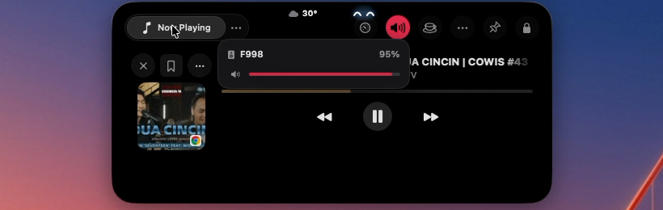
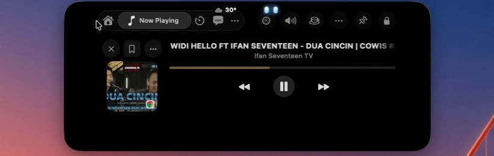

# Notchy – Nusa Animation Edition 🏝️✨

> **Dynamic Island & Notch enhancement for macOS featuring reactive mascot animations, real-time animated weather, and permanent update protection.**

---

## 📸 Preview & Screenshots

<div align="center">

### 1. Notch Pill (Compact Mode) with Mascot & Live Weather


*Displays real-time album art, animated weather icon (28°), audio visualizer, and smiling cyan mascot eyes `^^`.*

<br/>

### 2. Expanded Notch on Hover / Media Playback


*Mascot eyes actively react to cursor hover and active media playback.*

<br/>

### 3. Idle Natural Eye State


*Mascot eyes `··` blink naturally, track cursor direction, and transition to a peaceful sleep mode when idle.*

</div>

---

## 🎥 Video Demo

A screen recording demonstration is included in [`assets/demo.mov`](assets/demo.mov).  
You can view the video directly in this repository or download it locally.

---

## ✨ Key Features

### 🌤️ 1. Animated Weather in Dynamic Island (Compact Pill)
- ☀️ **Sunny:** Continuous 360° rotating sun rays with a warm glowing core.
- 🌧️ **Rain / Drizzle:** Soft cloud layer with staggered falling raindrops. Dynamic angle shifts during windy rain.
- ⚡ **Thunderstorm:** Storm clouds with periodic electric yellow lightning strikes and flashes.
- 💨 **Wind / Breeze:** Smoothly sweeping breeze lines gliding horizontally.
- ☁️ **Overcast / Cloudy:** Dual floating cloud layers with gentle ambient motion.
- 🌙 **Clear Night:** Subtle glowing crescent moon with twinkling stars.
- 🌡️ **Accurate Real-Time Temperature:** Synchronized directly with native macOS Apple Weather (local database and Accessibility UI) instead of unreliable IP geolocation.

### 👀 2. Reactive Mascot Eyes (Nusa Style)
- **Natural Blinking:** Randomized, realistic blink timing.
- **Glancing & Tracking:** Eyes look left and right following cursor movements.
- **Happy Smile (`^^`):** Joyful expression reacting to mouse hover and active music playback.
- **Sleeping Mode:** Gently falls asleep with floating "z" particle animations after prolonged inactivity.
- **Vibrant Glow:** Crisp cyan / neon blue glow inspired by the Nusa notch design.

### 🛡️ 3. Permanent Anti-Update & Freeze Protection
- **Sparkle Auto-Update Disabled:** `SUEnableAutomaticChecks` and `SUAutomaticallyUpdate` locked to `false`.
- **Bypass Forced Update Gates:** Internal version set to build `999999`, preventing remote update-policy locks.
- **Neutralized Endpoints:** Remote update endpoints rerouted to `127.0.0.1:0`.
- **Cross-Mac Compatibility:** Safe to copy or install on any Mac without risking automatic overwrites or update prompts.

### 🐾 4. Custom Animated Sprites & Optimized Performance
- Includes 130+ custom WebP sprites for notch pets and companions.
- **Zero CPU Overhead:** Built entirely with native SwiftUI and GPU-accelerated *WindowServer* rendering for minimal battery impact.

---

## 📥 Installation

### 💻 Installing on a New or Secondary Mac (Automated Script)
To install Notchy Nusa Edition on another Mac or perform a clean install:

```bash
# 1. Clone the repository
git clone https://github.com/nesia26/notchy-nusa.git
cd notchy-nusa

# 2. Grant script execution permissions
chmod +x scripts/install.sh scripts/patch_notchy.sh

# 3. Run the automated installer
./scripts/install.sh
```

The installer script will:
1. Copy `Notchy.app` to `/Applications/Notchy.app`.
2. Apply anti-update rules to macOS `UserDefaults`.
3. Clear Gatekeeper quarantine attributes (`xattr -cr`).
4. Re-sign the bundle with an ad-hoc signature for macOS compatibility.
5. Launch Notchy immediately.

---

### 🔧 Alternative: Patching an Existing Notchy Installation
If you already have official `Notchy.app` installed in your Applications folder:

```bash
./scripts/patch_notchy.sh /Applications/Notchy.app
```

---

### 🔄 Resetting macOS Privacy Permissions (If Needed)
If you ever need to reset all system permissions granted to Notchy (Accessibility, Screen Recording, Location, etc.):

```bash
tccutil reset All dev.notchy.app
```

---

### 📱 iPadOS Edition (.ipa)
1. Download `Notchy_iPad.ipa` from the [**Releases**](https://github.com/nesia26/notchy-nusa/releases) section.
2. Install it on your iPad using your preferred sideloading utility:
   - **TrollStore:** Direct permanent install without 7-day revokes (Recommended).
   - **Sideloadly / AltStore / Scarlet:** Sideload and install using your Apple ID.

---

## 🛠️ Architecture & How It Works

```
Notchy.app
├── Contents/MacOS/Notchy        <- Patched Mach-O (LC_LOAD_DYLIB @rpath/NusaNotch.dylib)
├── Contents/Frameworks/
│   ├── NusaNotch.dylib         <- Universal Shared Library (x86_64 + arm64)
│   └── Sparkle.framework       <- Disabled update framework
└── Contents/Info.plist          <- Build 999999, SUFeedURL = 127.0.0.1:0
```

1. **`NusaNotch.dylib`:** Native SwiftUI/AppKit universal dynamic library containing the living mascot view, eye shapes (`HappyArcShape`, `SleepingEyeShape`, `MascotEyeView`), `AnimatedWeatherIconView`, and `WeatherManager`.
2. **Mach-O Injection:** The main `Notchy` Mach-O binary includes an `@rpath/NusaNotch.dylib` load command. The dynamic linker (`dyld`) loads this dylib on application startup.
3. **Window Attachment:** The dylib locates the notch overlay window (`NotchWindow`) and injects a transparent `ClickThroughHostingView` into the compact pill region.

---

## 🔨 Building the Shared Library from Source (Optional)
If you want to customize the SwiftUI logic in `src/NusaNotch.swift`:

```bash
chmod +x scripts/build_dylib.sh
./scripts/build_dylib.sh
```

---

## 👨‍💻 Credits & Attribution

- **Original App:** [Notchy](https://notchy.dev/) by [Vishva Variya](https://github.com/vishvavariya)
- **Living Notch Concept & Inspiration:** [Nusa](https://rama2555.github.io/nusa) by [Rama (rama2555)](https://github.com/rama2555)
- **Mod, Weather Animations & Anti-Update:** [Iqbal (@nesia26)](https://github.com/nesia26)
